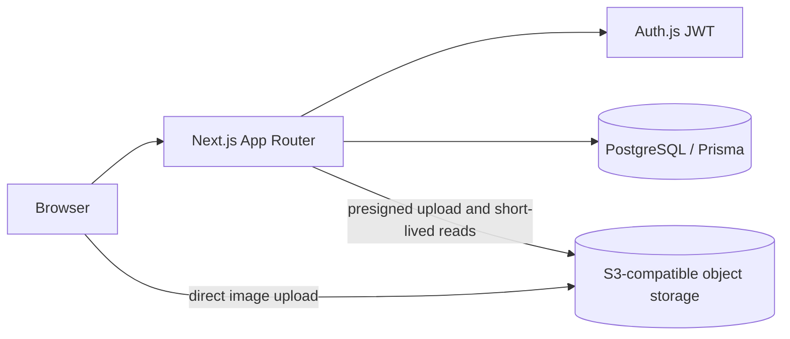

# Nexvia Market

A multi-vendor marketplace built with Next.js 16, React 19, TypeScript, Tailwind CSS v4, Auth.js, PostgreSQL, Prisma 7, and integer-paise commission accounting. The storefront uses a search-first text list; product images appear on product detail and vendor product forms.

## Current features

- Customer, vendor, and admin accounts with server-side role and ownership checks.
- Vendor product management, admin vendor approval, checkout, shipping details, order history, and order status controls.
- Commission and seller earnings stored as integer-paise-derived PostgreSQL values.
- Optional S3-compatible product image uploads. Uploads use a short-lived presigned form, enforce JPEG/PNG/WebP and a 2 MB limit, and store object keys on `Product.image`.
- S3 outages disable image upload and image delivery without preventing text-only product management or taking down the rest of the site.

## Architecture

PostgreSQL remains the source of truth for products, stock, orders, and the ledger. Product image keys use `products/{vendorId}/{randomId}.{jpg|png|webp}`. Uploads are authorized against the current approved vendor. On save, the server checks object size, declared content type, and file signature. Replacing or deleting a product attempts to delete its prior object.

## Routes

| Route | Purpose |
| --- | --- |
| `/` | Search and browse products |
| `/products/[id]` | Product details and image |
| `/cart`, `/checkout` | Cart and customer checkout |
| `/orders`, `/orders/[id]` | Customer order history and details |
| `/vendor` | Vendor overview |
| `/vendor/products` | Vendor product management and image forms |
| `/vendor/orders`, `/vendor/earnings` | Vendor order and earnings views |
| `/admin` | Vendor approvals |
| `/admin/orders`, `/admin/commission` | Marketplace order and commission controls |
| `POST /api/vendor/products/image-upload` | Create a scoped, short-lived S3 upload form |
| `GET /api/product-images?key=…` | Redirect to a short-lived URL for an approved product image |

## Local setup

1. Install Node.js 24 and PostgreSQL access, then run `npm install`.
2. Copy `.env.example` to `.env` and set `DATABASE_URL`, `NEXTAUTH_SECRET`, and `NEXTAUTH_URL`.
3. Apply migrations with `npx prisma migrate deploy`.
4. Generate the client with `npx prisma generate`.
5. Start the app with `npm run dev` and open <http://localhost:3000>.

Image storage is optional. Without the `S3_*` variables, vendors can create and edit text-only listings. To enable uploads, set `S3_BUCKET`, `S3_REGION`, `S3_ACCESS_KEY_ID`, and `S3_SECRET_ACCESS_KEY`. Set `S3_ENDPOINT` for compatible providers and `S3_FORCE_PATH_STYLE=true` when required. Configure the bucket CORS policy to allow browser `POST` uploads from the app's origins and allow the `Content-Type` header. The bucket should remain private; product reads use a short-lived signed URL.

Cloudflare R2 is one S3-compatible hosted option. Its current standard-storage free tier includes 10 GB-month, 1 million Class A requests, and 10 million Class B requests monthly, with free internet egress; usage beyond included amounts is billed. Check the [current R2 pricing](https://developers.cloudflare.com/r2/pricing/) before deployment. R2 supports an S3 API endpoint and access keys; set those in environment variables rather than committing them.

## Environment variables

| Variable | Required | Purpose |
| --- | --- | --- |
| `DATABASE_URL` | Yes | PostgreSQL connection string |
| `NEXTAUTH_SECRET` | Yes | JWT/session signing secret |
| `NEXTAUTH_URL` | Yes | Canonical app URL |
| `S3_ENDPOINT` | No | S3-compatible endpoint; omit for AWS S3 |
| `S3_REGION` | No | Storage region; defaults to `us-east-1` |
| `S3_BUCKET` | No | Private image bucket |
| `S3_ACCESS_KEY_ID` | No | Storage access key |
| `S3_SECRET_ACCESS_KEY` | No | Storage secret key |
| `S3_FORCE_PATH_STYLE` | No | Set `true` for providers that require path-style addressing |

Never commit `.env` files or production credentials.

## Verification

- `npx tsc --noEmit` — TypeScript check.
- `npm run lint` — ESLint check.
- `npm run build` — production build; database-backed routes need request-time rendering and a reachable PostgreSQL database at runtime.
- `npm run verify` — checks order totals and vendor balances against the PostgreSQL ledger; requires a reachable configured database.
- `npx tsx scripts/test-commission.ts` — commission rounding checks.

## Dependencies added for image storage

- `@aws-sdk/client-s3`: S3-compatible object operations.
- `@aws-sdk/s3-request-presigner`: short-lived signed image reads.
- `@aws-sdk/s3-presigned-post`: upload policy with server-enforced content-type and 2 MB size constraints.
