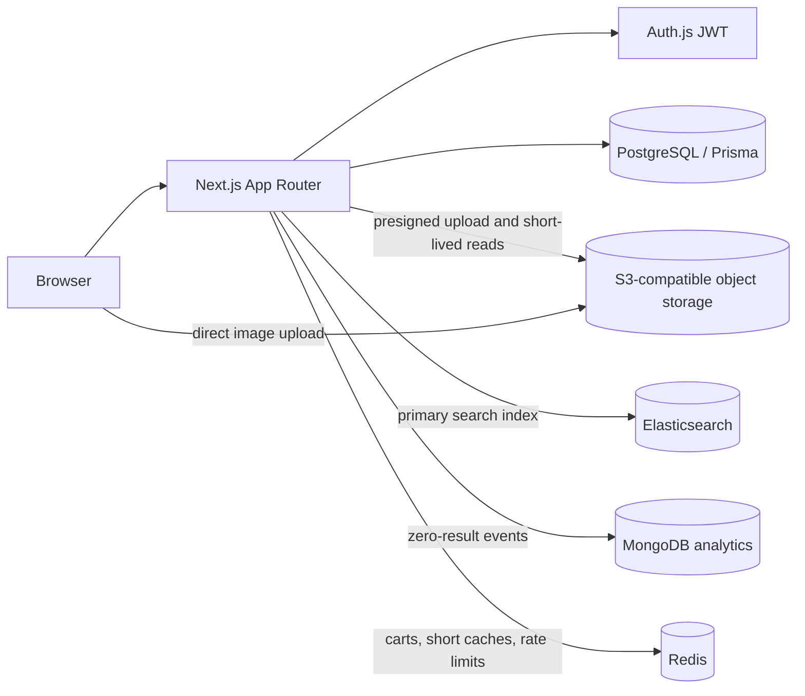

# Nexvia Market

A multi-vendor marketplace built with Next.js 16, React 19, TypeScript, Tailwind CSS v4, Auth.js, PostgreSQL, Prisma 7, and integer-paise commission accounting. The storefront uses a search-first text list; product images appear on product detail and vendor product forms.

## Current features

- Customer, vendor, and admin accounts with server-side role and ownership checks.
- Vendor product management, admin vendor approval, checkout, shipping details, order history, and a guarded paid → packed → shipped → delivered lifecycle. Admin cancellation restores stock and reverses seller earnings in one transaction.
- Order status history with actor and timestamp, shown in customer, vendor, and admin order views.
- Commission and seller earnings stored as integer-paise-derived PostgreSQL values.
- Optional S3-compatible product image uploads. Uploads use a short-lived presigned form, enforce JPEG/PNG/WebP and a 2 MB limit, and store object keys on `Product.image`.
- Optional typo-tolerant Elasticsearch search, filters, sorting, paging, and header autocomplete; PostgreSQL search remains the fallback.
- Optional MongoDB collection for zero-result search analytics.
- Optional Redis carts for signed-in customers, short-lived category/search caches, rate limits, and request idempotency; guest carts stay in local storage.
- S3 outages disable image upload and image delivery without preventing text-only product management or taking down the rest of the site.

## Architecture

PostgreSQL remains the source of truth for products, stock, orders, and the ledger. Product image keys use `products/{vendorId}/{randomId}.{jpg|png|webp}`. Uploads are authorized against the current approved vendor. On save, the server checks object size, declared content type, and file signature. Replacing or deleting a product attempts to delete its prior object.

### Data model boundaries

| Store | Data |
| --- | --- |
| PostgreSQL | Users and roles; vendors and balances; products, stock, and rating aggregates; orders with per-customer idempotency keys, order items, shipping data, status history, and commission ledger values; marketplace settings |
| Elasticsearch | Rebuildable search documents for approved products, including title suggestions, category, price, stock, vendor, rating, and creation time |
| MongoDB | Optional zero-result search events only in this phase; later review and coupon documents are planned |
| S3-compatible object storage | Private product image objects; PostgreSQL stores the object key |

Elasticsearch is derived data and can be reconstructed with `npm run reindex`. PostgreSQL remains authoritative if Elasticsearch or MongoDB is unavailable.

## Routes

| Route | Purpose |
| --- | --- |
| `/` | Search and browse products |
| `/products/[id]` | Product details and image |
| `/cart`, `/checkout` | Cart and customer checkout |
| `/orders`, `/orders/[id]` | Customer order history and details |
| `/vendor` | Vendor overview |
| `/vendor/products` | Vendor product management and image forms |
| `/vendor/orders`, `/vendor/earnings` | Vendor order and earnings views |
| `/admin` | Vendor approvals |
| `/admin/orders`, `/admin/commission` | Marketplace order and commission controls |
| `POST /api/vendor/products/image-upload` | Create a scoped, short-lived S3 upload form |
| `GET /api/product-images?key=…` | Redirect to a short-lived URL for an approved product image |
| `GET /api/search/suggest?q=…` | Header autocomplete suggestions |
| `/api/cart` | Authenticated cart sync; Redis-backed when available, local-storage fallback otherwise |

### Order lifecycle

New checkouts start as `PAID`. A vendor can mark an order packed and then shipped only when every item belongs to that vendor. The admin can advance mixed-vendor orders and mark shipped orders delivered. The admin can cancel pending or undelivered orders; the transaction restores product stock, reverses vendor balance credits, and appends a status history event. Every transition checks the current state in the database to reject stale or repeated updates.

## Local setup

1. Install Node.js 24 and PostgreSQL access, then run `npm install`.
2. Copy `.env.example` to `.env` and set `DATABASE_URL`, `NEXTAUTH_SECRET`, and `NEXTAUTH_URL`.
3. Apply migrations with `npx prisma migrate deploy`.
4. Generate the client with `npx prisma generate`.
5. Start the app with `npm run dev` and open <http://localhost:3000>.

Image storage is optional. Without the `S3_*` variables, vendors can create and edit text-only listings. To enable uploads, set `S3_BUCKET`, `S3_REGION`, `S3_ACCESS_KEY_ID`, and `S3_SECRET_ACCESS_KEY`. Set `S3_ENDPOINT` for compatible providers and `S3_FORCE_PATH_STYLE=true` when required. Configure the bucket CORS policy to allow browser `POST` uploads from the app's origins and allow the `Content-Type` header. The bucket should remain private; product reads use a short-lived signed URL.

### Local optional services

Start Elasticsearch, Redis, and MongoDB for local development with `docker compose up -d`. The local Elasticsearch and Redis containers run without authentication and must not be exposed publicly. Copy the local service values from `.env.example`; replace demo MongoDB credentials if the ports are accessible outside your machine. Elasticsearch is the preferred search index when configured. On connection errors or when `ELASTICSEARCH_URL` is blank, the app uses PostgreSQL search. MongoDB is only for analytics and can be left blank without affecting search or checkout. Without Redis, signed-in carts use the same local-storage fallback as guest carts, and rate limits use per-process counters.

Run `npm run reindex` after starting Elasticsearch or after changing the index mapping. This rebuilds the product index from approved PostgreSQL products. Product create, edit, delete, and vendor approval changes sync records incrementally when Elasticsearch is available.

Hosted starting points (free quotas and trials can change): [Elastic Cloud currently offers a 14-day trial](https://www.elastic.co/cloud/elasticsearch-service/signup/); for ongoing no-cost Elasticsearch development, run the local Docker service. [MongoDB Atlas Free clusters have a 512 MB storage limit](https://www.mongodb.com/docs/atlas/reference/faq/storage/). [Redis Cloud offers a 30 MB free database](https://redis.io/docs/latest/operate/rc/databases/create-database/create-free-database/); [Upstash Redis currently lists a 256 MB, 500,000-command monthly free plan](https://upstash.com/pricing/redis/). Review each provider's current limits and terms before deploying.

Cloudflare R2 is one S3-compatible hosted option. Its current standard-storage free tier includes 10 GB-month, 1 million Class A requests, and 10 million Class B requests monthly, with free internet egress; usage beyond included amounts is billed. Check the [current R2 pricing](https://developers.cloudflare.com/r2/pricing/) before deployment. R2 supports an S3 API endpoint and access keys; set those in environment variables rather than committing them.

## Environment variables

| Variable | Required | Purpose |
| --- | --- | --- |
| `DATABASE_URL` | Yes | PostgreSQL connection string |
| `NEXTAUTH_SECRET` | Yes | JWT/session signing secret |
| `NEXTAUTH_URL` | Yes | Canonical app URL |
| `S3_ENDPOINT` | No | S3-compatible endpoint; omit for AWS S3 |
| `S3_REGION` | No | Storage region; defaults to `us-east-1` |
| `S3_BUCKET` | No | Private image bucket |
| `S3_ACCESS_KEY_ID` | No | Storage access key |
| `S3_SECRET_ACCESS_KEY` | No | Storage secret key |
| `S3_FORCE_PATH_STYLE` | No | Set `true` for providers that require path-style addressing |
| `ELASTICSEARCH_URL` | No | Elasticsearch URL; empty disables the external index |
| `ELASTICSEARCH_INDEX` | No | Index name; defaults to `nexvia-products` |
| `ELASTICSEARCH_API_KEY` | No | Elasticsearch API key for hosted deployments |
| `ELASTICSEARCH_USERNAME`, `ELASTICSEARCH_PASSWORD` | No | Basic auth when API key auth is not used |
| `MONGODB_URI` | No | MongoDB connection string for analytics |
| `MONGODB_DATABASE` | No | Mongo database name; defaults to `nexvia` |
| `REDIS_URL` | No | Redis connection URL; empty enables local cart and cache fallbacks |

Never commit `.env` files or production credentials.

Session lookups are not cached. Roles and account state should reflect the current Auth.js JWT on each request; a Redis session cache could make account changes and security revocation take effect late. Search cache values expire after 45 seconds and use a version key that mutations increment. Category cache values expire after 5 minutes and are deleted when products or vendor approvals change.

## Verification

- `npx tsc --noEmit` — TypeScript check.
- `npm run lint` — ESLint check.
- `npm run build` — production build; database-backed routes need request-time rendering and a reachable PostgreSQL database at runtime.
- `npm run verify` — checks order totals and vendor balances against the PostgreSQL ledger; requires a reachable configured database.
- `npm run test:idempotency` — verifies the database unique constraint inside a transaction that rolls back its temporary test order.
- `npx tsx scripts/test-commission.ts` — commission rounding checks.
- `npm run reindex` — rebuild Elasticsearch from approved PostgreSQL products; prints `SKIP` if Elasticsearch is not configured.

## Dependencies added for image storage

- `@aws-sdk/client-s3`: S3-compatible object operations.
- `@aws-sdk/s3-request-presigner`: short-lived signed image reads.
- `@aws-sdk/s3-presigned-post`: upload policy with server-enforced content-type and 2 MB size constraints.
- `@elastic/elasticsearch`: typed Elasticsearch index/search client.
- `mongodb`: MongoDB driver for optional analytics events.
